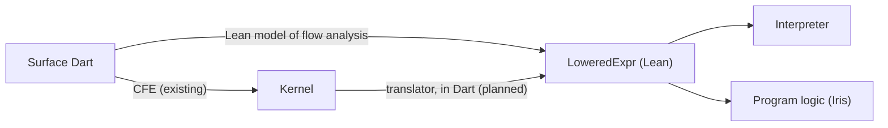
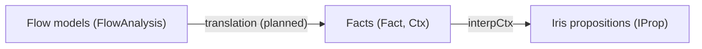

# Lean formalization of Dart

This directory holds a machine-checked model of parts of Dart, written in
[Lean 4](https://lean-lang.org/). It uses [Mathlib](https://github.com/leanprover-community/mathlib4)
and [iris-lean](https://github.com/leanprover-community/iris-lean), the Lean port of the
[Iris](https://iris-project.org/) separation-logic framework.

The model is maintained by the Dart team, whose members aren't necessarily Lean or Iris experts.
See [Documentation conventions](#documentation-conventions).

## Goals

- **Prove flow analysis sound.** Prove, for all programs, that the static types and promotions that
  Dart's flow analysis computes are sound with respect to Dart's run-time semantics: whenever flow
  analysis says a variable or property has a type, every execution agrees.
- **Evaluate language proposals.** When a new language feature or a change to the specification is
  proposed, updating the model and its proofs (possibly with the help of AI agents) can show
  whether the proposal preserves flow analysis soundness and other core invariants, before it is
  implemented.
- **Verify Dart code** (longer term). Translate important Dart code, such as core library
  algorithms or compiler components, to the lowered representation described below, and use Iris to
  prove that it meets its specification.

## Three representations of Dart code



1. **Surface Dart**: code as users write it, with inferred types and syntactic sugar.
2. **Kernel**: what the common front end (CFE) produces from surface Dart. Kernel is designed for
   compilers and back ends, so it includes back-end-specific flags and lowerings that may complicate
   formal reasoning.
3. **`LoweredExpr`** (`DartLang/Lowered.lean`): a lower-level representation of Dart in Lean, with
   explicit type and promotion annotations. Unlike Kernel, it is designed for stating a formal
   semantics and proving things about it, not for executing efficiently.

The translations between them:

- **Surface Dart to Kernel**: the CFE, in the Dart SDK.
- **Surface Dart to `LoweredExpr`**: the Lean model of flow analysis (`FlowAnalysis/`), which models
  flow analysis together with the type resolution and inference that it is interleaved with, and
  produces `LoweredExpr`s.
- **Kernel to `LoweredExpr`** (planned): a translator written in Dart, as a visitor over Kernel that
  emits `LoweredExpr`s as Lean source. Writing it in Dart keeps as much of the project as possible in
  a language that Dart engineers can easily review and maintain.

## Consumers of `LoweredExpr`

Both consumers use the same definition of Dart's run-time semantics (`DartSemantics/`), a
[small-step operational semantics](https://en.wikipedia.org/wiki/Operational_semantics#Small-step_semantics)
of `LoweredExpr`, which defines how a program runs, one small step at a time:

- **An interpreter**: a fuel-bounded loop around the semantics' single step, proved to agree with
  it. Running Dart language tests through the CFE, the Kernel translator and the interpreter will
  check both the translator and that the semantics matches how Dart programs actually behave.
- **A program logic**: the semantics, used with iris-lean, to prove things about programs:
  - **Flow analysis soundness**: every `LoweredExpr` that the Lean model of flow analysis produces
    runs safely, and agrees with its type and promotion annotations.
  - **Program verification**: specific functions or methods (translated from Kernel) meet their
    specifications.

## How flow analysis soundness is proved

Flow analysis and the program logic describe what is known at a point in a program at three
levels:



- **Flow models** are what flow analysis tracks at each point in a program (in the Dart
  implementation, `FlowModel`): for each variable, its promotion chain, whether it's definitely
  assigned, the types it has been tested against, and so on. Much of this only matters to the
  analysis itself, for example to decide what is known after a join.
- **Facts** (`Fact`, in `DartSemantics/SemanticTyping.lean`) are simple statements that a running
  program can rely on at a point, such as "`x` is in scope" (`Fact.decl x`), "`x` holds a value that
  satisfies `T`" (`Fact.var x T`), or "`x` refers to an object whose instance variable `f` holds a
  value that satisfies `T`" (`Fact.field x f T`). A *context* (`Ctx`) is a list of facts.
- **Iris propositions** (`IProp`) are statements in the program logic about the run-time heap.
  Local variables' cells can change, so the judgment owns them exclusively (`interpEnv`), and
  tracks what they hold with an *environment* (`Env`). Each fact means an Iris proposition about
  the environment (`interpFact`), and a context means that all of its facts hold (`interpCtx`). For
  example, `Fact.var x T` means that `x` is bound to a cell, which the environment says holds a
  value whose dynamic type is a subtype of `T` (`interpVal`).

The semantic typing judgment `SemTyped Δb m T Δa` connects facts to how programs run: given
ownership of the cells of the variables in scope, if the facts in `Δb` hold before `m` runs, then
`m` doesn't get stuck, and if it completes normally with a value `v`, then `v` satisfies `T`, and
the facts in `Δa v` hold afterwards (with the ownership of the cells back). It is defined with an
Iris weakest precondition, so it is proved with the program logic. `Compat.lean` proves a typing
rule for each kind of expression, and the safety theorem (`safety`, in `Safety.lean`) turns the
judgment into a statement about runs that doesn't mention Iris: an expression that is semantically
well typed, started in a state where its variables are bound to suitable cells and the facts in
`Δb` hold, never gets stuck. When the semantics checks promotions (`PromotionChecks.verify`), a
promotion check that fails gets stuck, so this includes every promotion check passing.

The soundness theorem for flow analysis, which comes next, will connect flow models to facts:

1. Translate each flow model to the facts it implies, with an ordinary Lean function.
2. Prove that, for each construct, the `LoweredExpr` that flow analysis produces is semantically
   well typed, from the facts of the flow model before it to the facts of the flow model after it,
   using the typing rules.

Then `safety` says that every program that flow analysis accepts runs without getting stuck, and
agrees with the types and promotions that flow analysis computed. Keeping the levels separate
means that the proofs about flow models (joins, demotions and so on) are ordinary Lean proofs,
without Iris, and that the program logic doesn't depend on how flow analysis represents its models.

For example, `Tests/DartSemantics/Corollaries.lean` proves `{ x as T; x }` (`castThenRead`) safe
this way. Beforehand, `x` holds a value that satisfies some subtype `U` of its static type: the
fact `Fact.var x U`. The cast promotes `x` to `T`, which flow analysis records in `x`'s promotion
chain. The typing rule for the cast (`SemTyped.as_var`) guarantees the matching fact
`Fact.var x T` afterwards, which is what the typing rule for the promoted read of `x`
(`SemTyped.var`) relies on.

## Reading the Iris parts

The program logic (`DartSemantics/GhostState.lean` onward) uses iris-lean, whose notation and
vocabulary come from the separation logic literature. This section is a short guide to the parts
that appear here, for readers who haven't used Iris. The [Iris lecture
notes](https://iris-project.org/tutorial-material.html) explain them properly.

**Propositions about resources.** An Iris proposition (`IProp`) doesn't just say whether something
is true; it describes *resources* that a part of a proof owns, such as heap cells. Most of the
notation combines propositions:

- `P ⊢ Q` (*entails*): owning what `P` describes is enough to have `Q`. A theorem `⊢ Q` says that
  `Q` holds with no resources at all. `P ⊣⊢ Q` means each entails the other.
- `P ∗ Q` (*separating conjunction*, "P and separately Q"): the resources split into two disjoint
  parts, one satisfying `P` and the other `Q`. So `ℓ ↦ c₁ ∗ ℓ ↦ c₂` is impossible: a cell can't be
  owned twice. `[∗map] ℓ ↦ c ∈ m, P ℓ c` is the separating conjunction of `P ℓ c` over the entries
  of the finite map `m`.
- `P -∗ Q` (*magic wand*): adding resources that satisfy `P` to the resources described by `P -∗ Q`
  gives resources that satisfy `Q`. It's separation logic's implication.
- `⌜φ⌝` lifts an ordinary Lean proposition `φ` into Iris; it owns nothing. `emp` and `True` own
  nothing either. `iprop(…)` marks a Lean term as an Iris proposition.
- `ℓ ↦ c` (*points-to*): the heap cell at `ℓ` holds `c`, and the proof owns it, so it may read and
  write it. `ℓ ↦{.discard} c` is a read-only, shareable version, for cells that never change.

**Persistent propositions.** Most resources can't be duplicated: for example, the law for reading a
variable needs the points-to for the variable's cell, and hands it back only once the read is done.
A *persistent* proposition (`Persistent P`), such as `⌜φ⌝` or `ℓ ↦{.discard} c`, is knowledge rather
than a resource: it can be duplicated freely (`P ⊢ P ∗ P`), so it never has to be handed over.
`□ P` (*persistently P*) keeps only the part of `P` that doesn't depend on owning anything, so it's
always persistent.

**Ghost state.** Besides the program's real state, Iris lets a proof own *ghost state*: resources
that exist only in the proof, which it can use to keep track of facts that the program doesn't
store. For example, a proof that a counter only ever increases might keep a ghost record of the
largest value the counter has held. The kinds of ghost state available are described by algebraic
structures that Iris calls *cameras*, which say how pieces of ghost state combine (`DartS` bundles
the cameras that this project uses). `|==> P` (*basic update*) means that `P` holds after updating
ghost state. (The points-to assertions are themselves ghost state, which the *state
interpretation*, `dartStateInterp`, ties to the real heap, but they can be read simply as
descriptions of the heap.) The [Iris lecture notes](https://iris-project.org/tutorial-material.html)
explain ghost state in detail.

**Invariants and masks.** An Iris *invariant* is a proposition that holds at every step of the
program, which any part of a proof may use, provided that it restores the invariant afterwards. A
*mask* is the set of invariants that a proof may currently use. The proofs here don't use
invariants, but iris-lean's interfaces mention masks.

**Weakest preconditions.** `WP e {{ o, Φ o }}` says that running `e` from the current state is
safe (it never gets stuck), and that if it completes with outcome `o`, then `Φ o` holds, together
with whatever resources the postcondition describes. A law of the form `P ⊢ WP e {{ Φ }}` reads like
a Hoare triple `{P} e {Φ}`. A weakest precondition can also be written in a more verbose form,
`WP e @ s; E {{ Φ }}`. In this form, `s` says whether the weakest precondition asserts that the
program doesn't get stuck (in the default case, `.NotStuck`, it does), and `E` is the weakest
precondition's mask.

**Later.** `▷ P` (*later P*) says that `P` holds one step of the program later. `▷` is used in some
deep parts of Iris to avoid circular reasoning that would otherwise lead to logical paradoxes. The
only thing that's important to understand about `▷` in order to follow the proofs in this project
is that when a proof reaches the point where it symbolically executes a step of the program, it may
remove one `▷` from the proposition to be proved. *Later credits* (the `hlc` parameters) are
resources that let a proof remove extra `▷`s; the proofs here don't use them.

**Adequacy.** The *adequacy* theorem (`adequacy`, in `GhostState.lean`) is what justifies
interpreting a proof made using Iris as a proof that the program will have the claimed behavior
when it's actually run (assuming that the semantics is defined accurately). It turns a weakest
precondition into an ordinary Lean statement about runs of the semantics, which doesn't mention
Iris.

**Proof mode.** Proofs of Iris propositions are written in iris-lean's *proof mode*, which shows
the goal as named Iris hypotheses above a conclusion, like Lean's own tactic state. Tactics in Iris
proof mode begin with an `i`, and are documented in [iris-lean's tactic
reference](https://github.com/leanprover-community/iris-lean/blob/master/docs/tactics.md).

## Layout

- `DartLang/` (`DartLang.lean`): the syntax and type representations shared by flow analysis and
  the semantics (`Types`, `SimpleTypes`, `RuntimeTypes`, `Elements`, `Loc`, `Lowered`). This library
  doesn't depend on iris-lean.
- `FlowAnalysis/` (`FlowAnalysis.lean`): the Lean model of flow analysis.
- `DartSemantics/` (`DartSemantics.lean`): the run-time semantics of `LoweredExpr`, the interpreter,
  and the program logic.
- `Tests/` (`Tests.lean`): tests, run by `lake test`.

## Building and testing

From this directory:

```sh
lake build   # builds the libraries, and checks every proof
lake test    # builds and runs the tests
```

## Current status

The architecture above is the long-term plan. So far, `LoweredExpr` and the models cover only a
small initial subset of Dart, chosen to establish the structure end to end; they will be expanded
incrementally.

What exists so far:

- `DartLang` has the type representation, the run-time subtype check (`RuntimeTypes`), and the
  initial `LoweredExpr`, with run-time values (`Value`), evaluation contexts (`EctxItem`) and
  outcomes (`Outcome`).
- `FlowAnalysis` has the model of promotion chains. The rest of the model of flow analysis, which
  produces `LoweredExpr`s from surface Dart, is being developed separately and isn't here yet.
- `DartSemantics` has the run-time semantics of `LoweredExpr`: the run-time state (`State`), how
  declarations resolve variable references to heap cells (`Resolve`), and the head-step relation
  (`HeadStep`), which is the definition of the semantics, made into an iris-lean language
  (`Language`). It also has the interpreter (`Interpreter`), proved to agree with the semantics,
  and the program logic: iris-lean's weakest-precondition logic, instantiated with a ghost heap
  that mirrors the run-time heap, with adequacy (`GhostState`), one law per head-step rule
  (`PrimitiveLaws`), and proof-mode tactics (`ProofMode`). On top of the program logic, it has a
  semantic typing judgment (`SemanticTyping`, with binding lemmas in `Bind`), typing rules proved
  sound (`Compat`), and a safety theorem (`Safety`): the basis for proving flow analysis sound.
  Connecting this to the model of flow analysis comes next.
- `Tests` has tests of the run-time subtype check and of the interpreter, specs of small programs
  proved with the program logic, two small programs proved safe with the typing rules
  (`Corollaries`), and a check that `SimpleType` obeys the laws that the typing rules assume.
- The Kernel translator hasn't been started.

## Documentation conventions

The Lean code is maintained by the Dart team, not by Lean or Iris specialists. So its comments
deliberately explain Lean 4, Mathlib and iris-lean idioms, syntax and tactics that a specialist
would find obvious. Reviewers are encouraged to ask about anything that isn't clear, so that the
answer can be captured in a comment in the code.

Terminology in doc comments follows the language specification (for example: dynamic type,
instance variable, completes normally, null object, cast expression, is-expression). In addition, a
value *satisfies* a type `T` if its dynamic type is a subtype of `T`. ("Is a subtype of" is kept
for the relation between two types.)
